# Team Timezone Wall

A fast, zero-dependency, single-file web clock wall designed to help distributed teams track timezones, working hours, daylight, and meeting overlap at a glance.

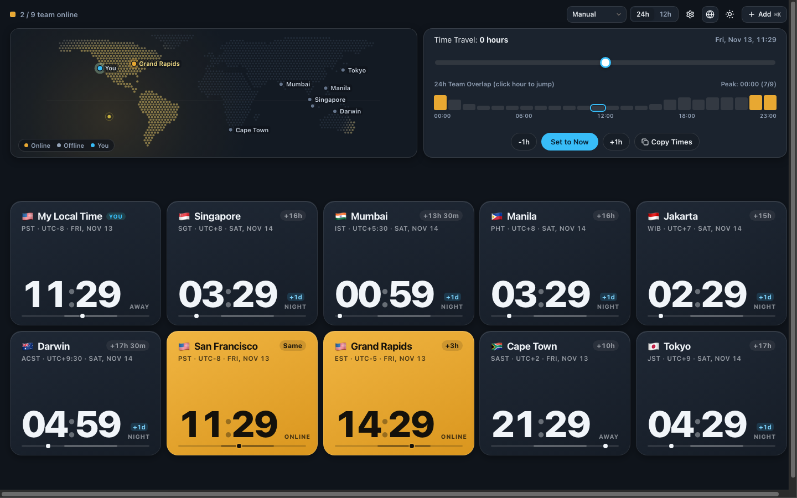

## Features

* **Zero-Dependency Single HTML File**: Pure HTML5, CSS3, Canvas/SVG, and Vanilla JavaScript with no external CDNs or build step—loads instantly and works offline.
* **Daylight Particle World Map**: Interactive `<canvas>` hex-dot world map with a live astronomical day/night solar terminator, color-coded team pins (`Online`, `Offline`, `You`), hover tooltips, click-to-highlight card sync, and a toolbar toggle.
* **20 Switchable Clock Bento Faces**: Pick from 20 distinct visual and mechanical clock faces in Settings (`⚙`):
  * **Classic (10)**: *Solar Gold*, *Swiss Grid*, *Analog Dial*, *Split-Flap*, *Braun 1978*, *Quartz LCD*, *Phosphor CRT*, *Aura Glass*, *Editorial Serif*, and *24h Orbital*.
  * **Wild & Experimental (10)**: *Binary LED*, *Sky Horizon*, *Word Clock*, *Nixie Tubes*, *Sonar Radar*, *Bauhaus Art*, *Cockpit Gauge*, *Liquid Tide*, *Receipt Bleed*, and *Sand Timer*.
* **Working Hours & 24h Team Overlap**: Cards in working hours highlight boldly with live online headcount, per-card interactive 24h timeline strips, and a clickable **24h Team Overlap** chart showing peak availability hours.
* **Time Travel & Quick Copy**: Scrub `-24h` to `+24h` (or drag any card's bottom 24h strip) to preview meeting times across the team, and click any card time or **Copy Times** to copy a formatted snapshot.
* **Fast City Search (`⌘K` / `Ctrl+K`)**: Search across global cities, country flags, timezone abbreviations (`IST`, `PST`, `SGT`, `NYC`), and IANA zones with live time previews and optional custom labels.
* **Flexible Organization & Preferences**: Toggle `24h` / `12h`, show/hide seconds, customize global or per-card working hours, drag-and-drop reorder cards, sort by `Manual`, `West → East`, or `Online first`, and switch between Light and Dark themes.
* **Refined UI & Micro-Interactions**: Built with a clean `shadcn/ui`-inspired Zinc token system (hairline borders, command-palette search dialog, sliding `24h`/`12h` tabs, range-filled slider, spring switches, and Sonner-style toasts) paired with GPU-composited `transitions.dev` motion (digit pop-ins, origin-aware popovers, theme icon swaps, subtle 3D card tilt, error shakes, and `prefers-reduced-motion` support).
* **Viewport-Fitted & Performant**: Adapts grid rows and columns across wide, tall, and mobile viewports with zero overflow, caches `Intl.DateTimeFormat` instances, updates DOM nodes in place, and aligns live ticks to minute boundaries when seconds are hidden.
* **Persistent State**: Clocks, theme, layout, and preferences are automatically saved in `localStorage`.

## How to Use

1. **Open the file**: Open `index.html` in any modern web browser.
2. **Add Clocks**: Click **+ Add** (or press `⌘K` / `Ctrl+K`), search for a city or timezone, and optionally enter a teammate or custom display name.
3. **Edit, Reorder, or Remove**: Hover any card to drag-reorder (in `Manual` sort), edit its label and custom working hours, or remove it (`×`).
4. **Explore Time & Overlap**: Drag the **Time Travel** slider, click any hour in the **24h Team Overlap** chart, or scrub along a card's bottom 24h strip. Click **Set to Now** (or double-click the slider) to return to live time.
5. **Customize Look**: Open **⚙ Settings** to switch between all 20 clock faces, toggle seconds, or adjust default working hours; use the globe and sun/moon icons to toggle the map and light/dark themes.

## Technologies Used

* **HTML5** & **Canvas 2D / Inline SVG**
* **Modern CSS3** (CSS Grid, Custom Properties, `tabular-nums` typography)
* **Vanilla JavaScript** (`Intl.DateTimeFormat`, `localStorage`, `requestAnimationFrame`) with zero external libraries or frameworks.

## Gallery

| Light Mode | Sky Horizon |
| :---: | :---: |
| 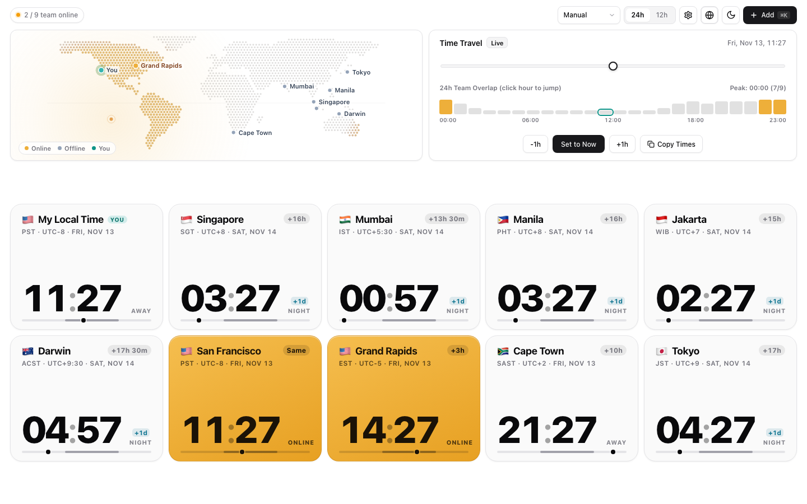 | 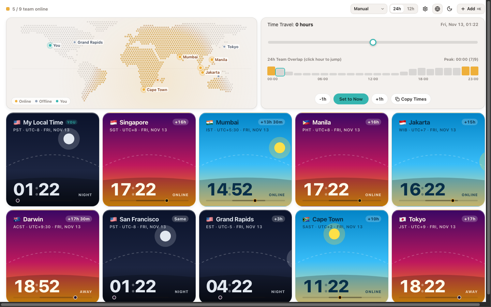 |

| Word Clock | Nixie Tubes |
| :---: | :---: |
| 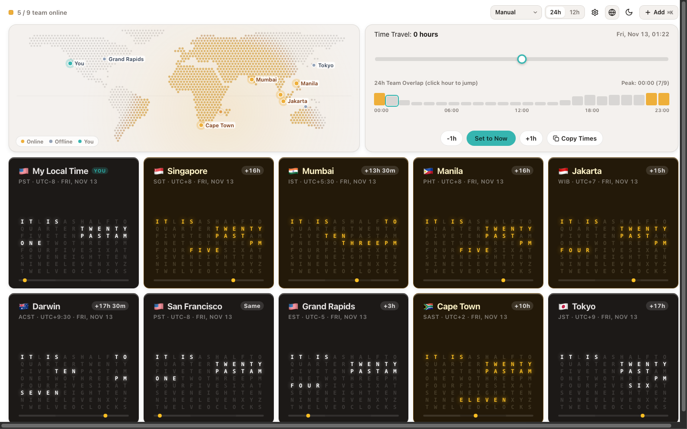 | 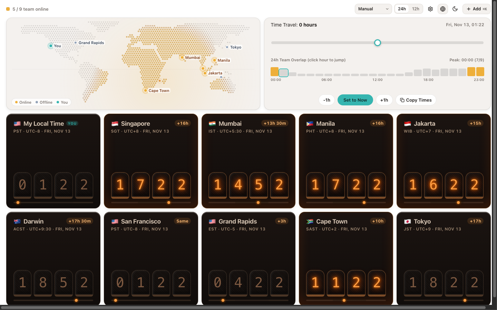 |

| Analog Dial | Split-Flap |
| :---: | :---: |
| 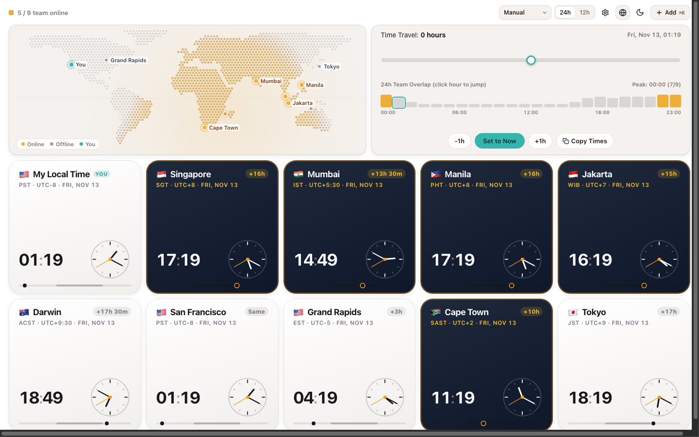 | 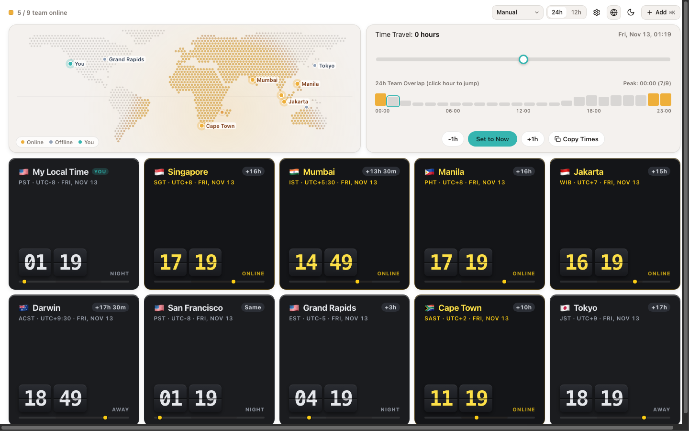 |

| Sonar Radar | Bauhaus Art |
| :---: | :---: |
| 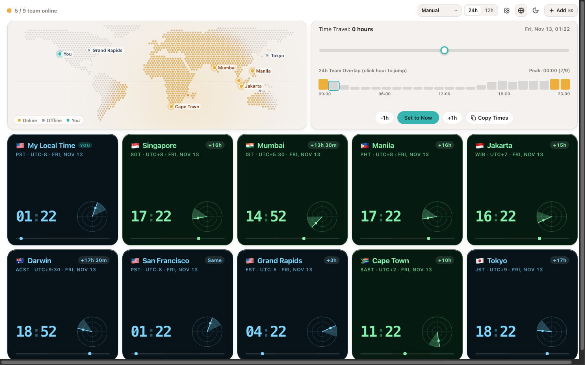 | 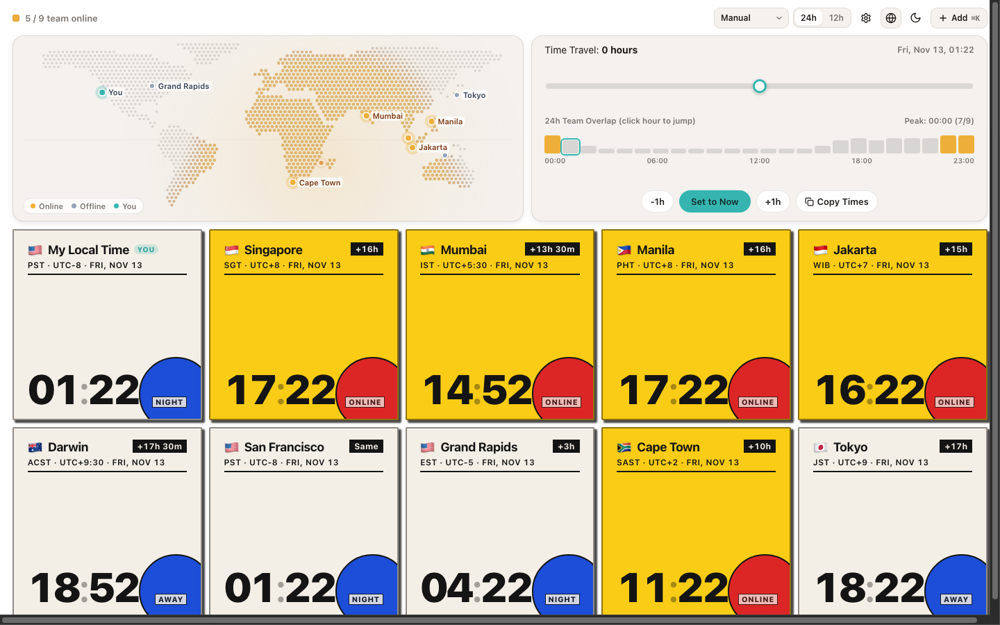 |

| Liquid Tide | Binary LED |
| :---: | :---: |
| 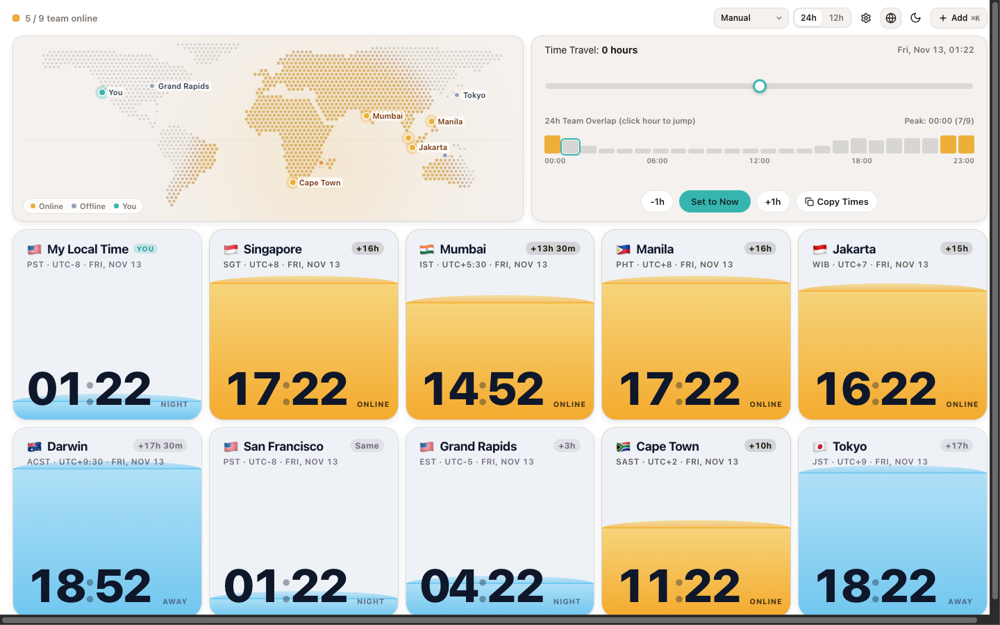 | 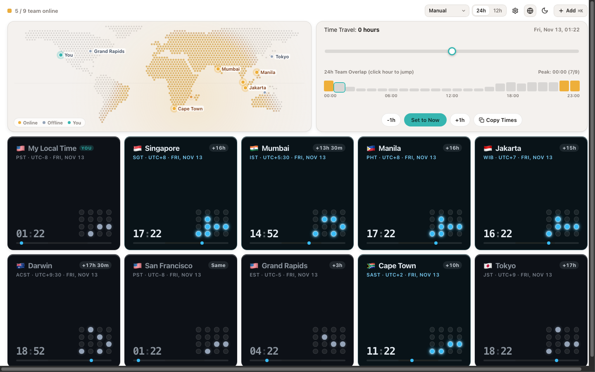 |
